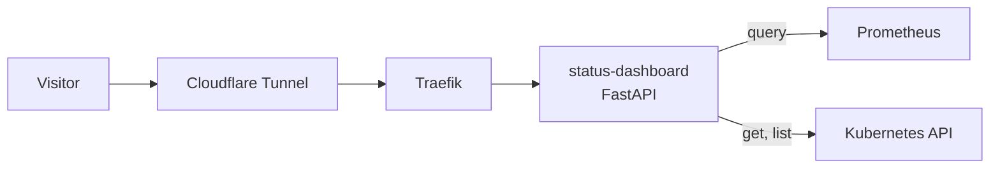
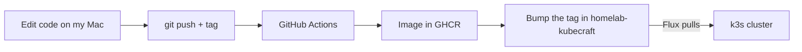

# status-dashboard


A small, read-only status page for my homelab. It shows live totals from a three-node k3s cluster (nodes, pods, CPU, memory, restarts, app health) and nothing else. It runs on that same cluster and is deployed by Flux, so a `git push` is the deploy.

It's also my DevOps portfolio. The numbers are real, they come from the cluster that hosts the page, and I can show you where each one comes from.

Will be live at: [status.projectpattie.com](https://status.projectpattie.com) · Cluster repo: [`homelab-kubecraft`](https://github.com/CravenCraven/homelab-kubecraft) · Build log: [projectpattie.com](https://projectpattie.com)

---

## Contents

- [Why this exists](#why-this-exists)
- [What it shows](#what-it-shows)
- [Where it runs](#where-it-runs)
- [Stack](#stack)
- [How it works](#how-it-works)
- [Design decisions](#design-decisions)
- [Repo layout](#repo-layout)
- [Getting started](#getting-started)
- [Operations](#operations)
- [Security](#security)
- [Roadmap](#roadmap)
- [Write-ups](#write-ups)

---

## Why this exists

I wanted a link I can give a recruiter that proves the homelab is running right now, not a screenshot from last month. A status page is also a good excuse to write a small service that talks to Prometheus and the Kubernetes API, ships as a container, and gets deployed the same way as everything else on the cluster.

The rule: **the page only reads.** It shows totals, it can't change anything, and nothing about the cluster's inside leaks out of it.

---

## What it shows

The design is Brutalist, black and magenta. Every number on it has a named source, written down in [docs/data-contract.md](docs/data-contract.md).

| Section | What it shows | Source |
|---|---|---|
| Headline numbers | Nodes ready, pods running, CPU %, memory %, restarts in 24 hours | Prometheus |
| Availability | 7-day availability | To be decided in the data contract |
| Nodes | One row per node | Kubernetes API |
| Live applications | Each app's health: healthy, degraded, or planned | Prometheus, plus `apps.yaml` for names and descriptions |
| Platform engineering | GitOps, zero open ports, secrets, monitoring, image updates, SSO | Written by hand |

App names, descriptions and the planned cards live in `apps.yaml` in this repo, not in the cluster. Moving an app from planned to live is a one-line edit.

The first version covers the KubeCraft apps only. The app list and namespace filter are settings, so I can decide later whether Brasil gets its own page or shares this one.

Pod and restart counts can be filtered by namespace. Node, CPU and memory numbers are for the whole machine, because both labs share the same three laptops.

---

## Where it runs

On the same three-node k3s cluster it reports on. Details of the nodes are in [homelab-kubecraft](https://github.com/CravenCraven/homelab-kubecraft#cluster).

| Node | Arch |
|---|---|
| `craventhegreat` | amd64 |
| `dell-node` | amd64 |
| `biggie-smalls` | arm64 |

The cluster mixes Intel and Apple Silicon, so the container image has to be built for both.

---

## Stack

### Running today

Nothing yet. The plan is written and the design is chosen.

### Planned

| Tool | Job | Why |
|---|---|---|
| Python 3.11+ | The app | It's on my study list, and the Prometheus and Kubernetes clients are good |
| FastAPI + uvicorn | One JSON route and the static page | Small, and it gives me a free test page at `/docs` |
| Prometheus HTTP API | CPU, memory, pod, restart and app-health numbers | Already running in the cluster through kube-prometheus-stack |
| Kubernetes Python client | The node list | Read-only, one call |
| Docker + buildx | Image for linux/amd64 and linux/arm64 | The cluster is mixed |
| GitHub Actions | Builds and pushes the image on a version tag | No manual builds |
| GitHub Container Registry | Public image | No pull secret needed, the page is public anyway |
| Flux | Deploys it from `homelab-kubecraft` | Same path as every other app |
| Cloudflare Tunnel + Traefik | Public access with no open ports | Same pattern as n8n and Authentik |

---

## How it works



1. The page is plain HTML and JavaScript, served by the app.
2. It calls one route, `GET /api/status`, on load and every 30 seconds.
3. The backend asks Prometheus for the numbers and the Kubernetes API for the node list, then builds one JSON.
4. The result is cached for 30 seconds, so a busy page can't hammer Prometheus.
5. If a fetch fails, the page shows STALE instead of blank numbers.

Only the page and `/api/status` leave the cluster. Prometheus and the Kubernetes API stay internal.

### How a change gets deployed



The code lives here. The Kubernetes files live in `homelab-kubecraft`, because Flux only watches that repo. Nobody runs `kubectl apply` by hand.

---

## Design decisions

| Decision | Why | Trade-off |
|---|---|---|
| **Public, no login** | The page is read-only and shows only totals, so a login would only get in a recruiter's way | Everything on it has to be safe for anyone to read, so the JSON is built from an allow-list |
| **Its own small API, not the page talking to Prometheus** | The browser never gets near Prometheus or the Kubernetes API, and I decide exactly what leaves the cluster | One more service to run |
| **Separate repo for the code** | App code and deploy config stay apart, the way a team would do it. Also gives Renovate an image to watch later | Two repos to keep in step |
| **Python + FastAPI** | Small, readable, and the docs page doubles as a test tool | Slower than Go, which doesn't matter at this size |
| **Image for amd64 and arm64** | `biggie-smalls` is arm64. A one-architecture image crashes on the wrong node with `exec format error` | Longer build |
| **Cache for 30 seconds** | A busy page can't hammer Prometheus | Numbers can be up to 30 seconds old |
| **Read-only ServiceAccount** | The app can only get and list nodes and pods | Flux status on the page needs one more rule, so it waits |
| **Descriptions in `apps.yaml`, not in the cluster** | Flipping a planned app to live is a one-line edit | The file has to be kept in step by hand |

---

## Repo layout

### Today

```
README.md
```

### Target

```
docs/
└── data-contract.md          # every number on the page, and where it comes from
static/
└── index.html                # the page
main.py                       # FastAPI app
apps.yaml                     # app names, descriptions, namespaces, planned apps
mock-status.json              # example response shape
requirements.txt
Dockerfile
.github/workflows/            # image build on version tags
```

The Kubernetes manifests live in `homelab-kubecraft`, under `apps/base/status-dashboard/` and `apps/staging/status-dashboard/`.

---

## Getting started

### Prerequisites

- Python 3.11 or newer
- `kubectl` with a kubeconfig for the cluster
- Prometheus reachable on `localhost:9090` through a port-forward
- Docker Desktop, for building the image

### Run it locally

Not built yet. The steps will go here once the backend runs.

### Configuration

| Variable | What it is |
|---|---|
| `PROM_URL` | Where to reach Prometheus. `localhost` on my Mac, the in-cluster address in the Deployment |

The Kubernetes client tries in-cluster config first and falls back to my kubeconfig, so the same code runs on my Mac and inside the pod.

### Deploy a change

Not set up yet. It will be a version tag here, then a tag bump in `homelab-kubecraft`.

---

## Operations

### If something is wrong

| What you see | What it means | What to do |
|---|---|---|
| Page shows STALE | The last fetch failed | Check that Prometheus is up, then the pod's logs |
| A number looks wrong | The query behind it is wrong, or the metric changed | Compare with Grafana, then check the query in the data contract |
| Pod won't start with `exec format error` | The image doesn't match the node's CPU | Check the image has both architectures |

### Known issues

None yet. This list gets filled in as things break.

---

## Security

| Area | Today | Planned |
|---|---|---|
| Cluster access | Nothing deployed yet | A ServiceAccount that can only get and list nodes and pods, checked with `kubectl auth can-i` |
| Routes | Nothing deployed yet | GET only. Anything else returns 405 |
| Data | Nothing deployed yet | Totals only: no IP addresses, no pod names, nothing that isn't in `apps.yaml` |
| Exposure | Not public yet | Cloudflare Tunnel only, no open ports. Locked down and checked before DNS is set |
| Secrets | None needed. None in this repo | Anything the cluster needs stays SOPS-encrypted in `homelab-kubecraft` |
| Container | Not built yet | Non-root, read-only filesystem, resource limits, a readiness probe |
| Login | None, on purpose | None |

---

## Roadmap

**Now**
- [ ] Data contract: a tested query for every number
- [ ] Backend: `/api/status` with real numbers
- [ ] Frontend: the page, with live numbers on my Mac

**Next**
- [ ] Dockerfile and GitHub Actions: public image for both architectures
- [ ] Deploy with Flux and expose through the tunnel at `status.projectpattie.com`
- [ ] Add it to Homepage

**Later**
- [ ] Flux sync status on the page
- [ ] Renovate watching the image
- [ ] Uptime Kuma
- [ ] Flip planned apps to live as they ship: Jellyfin, Paperless-ngx, CommaFeed, Wallabag, Nextcloud
- [ ] Decide whether the Brasil apps get their own page

---

## Write-ups

Coming soon: a runbook in `homelab-kubecraft` and a post on [projectpattie.com](https://projectpattie.com) once the page is live.
